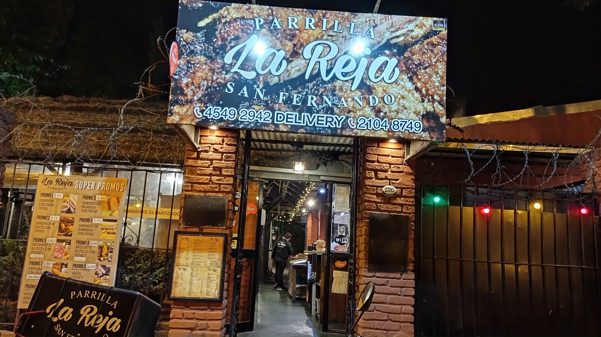
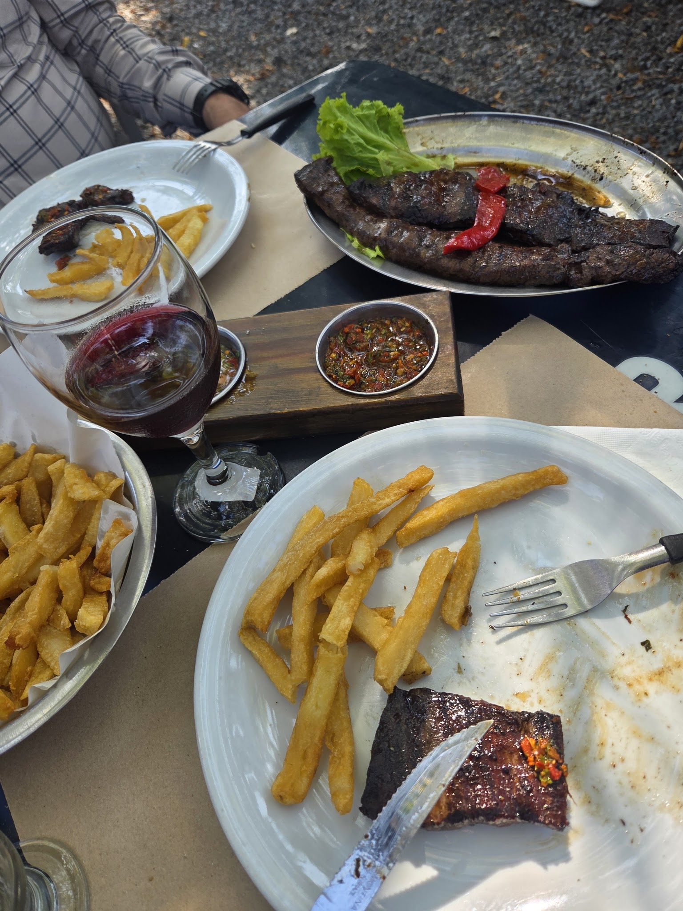
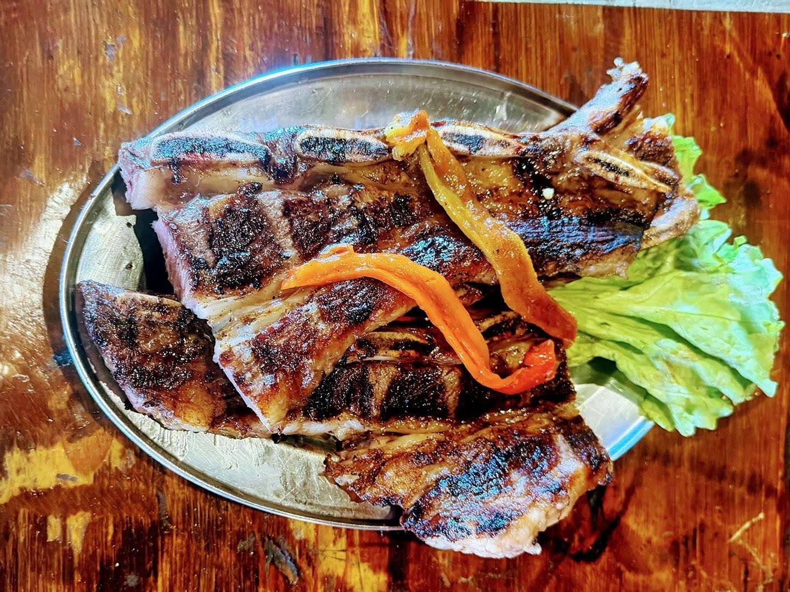
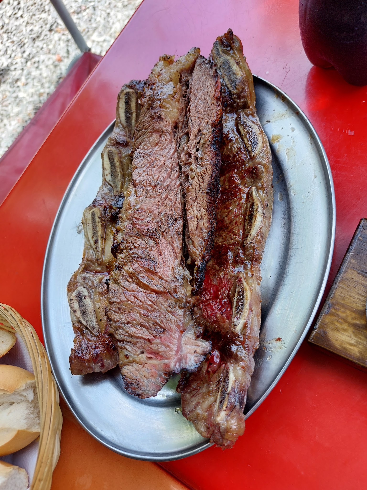
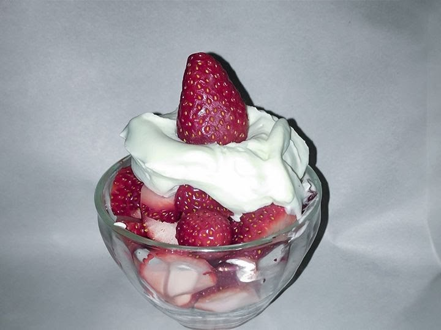
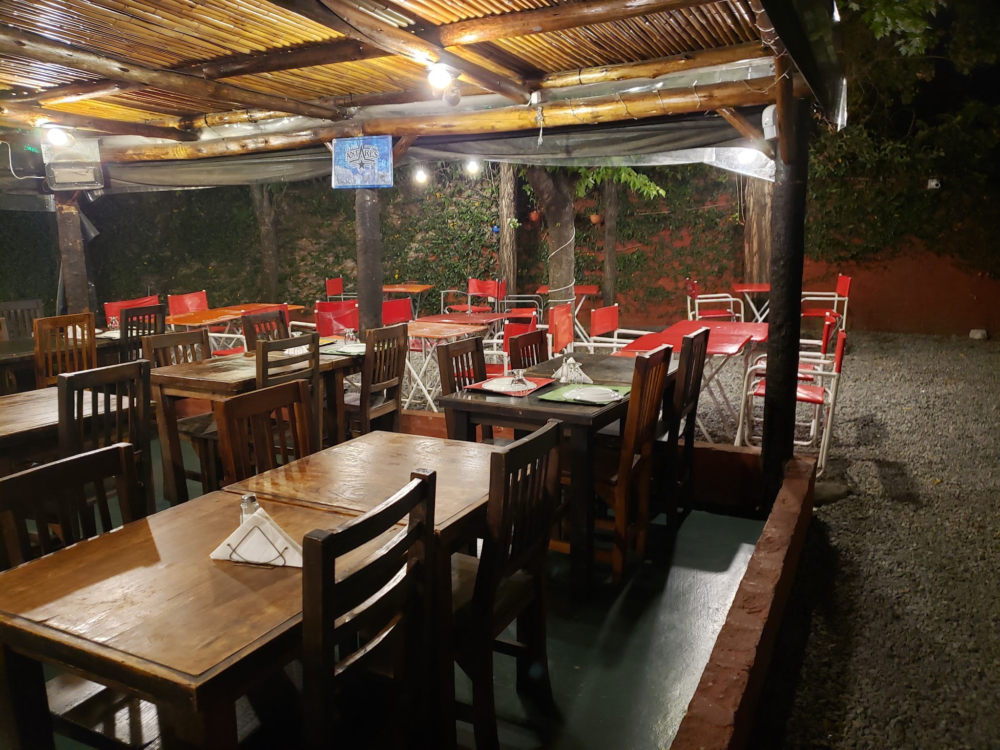

# Parrilla La Reja

> Extraído el 2026-10-20 19:43 desde [Google Maps](https://www.google.com/maps/place/Parrilla+La+Reja/data=!4m7!3m6!1s0x95bca529a770d72f:0xee58326e16d2618a!8m2!3d-34.448636!4d-58.5658253!16s%2Fg%2F11bbrlpn1j!19sChIJL9dwpymlvJURimHSFm4yWO4)

> ⚠️ La galería solo tiene 10 elementos: puede ser el diseño reducido de Google. Repite con `--sin-ficha --sin-resenas` (se acumula).

> ⚠️ La ficha salió recortada (vista limitada de Google): faltan galería de la ficha, horas punta, precio o atributos. Repite solo la ficha con `--sin-resenas --sin-galeria` (~1 min).

> ⚠️ Se han sacado 5 de 200 reseñas: Google sirvió la vista limitada (sin sesión a veces solo enseña 5). Repite con `--sin-ficha --sin-galeria` (~2 min) o inicia sesión una vez con `--login`.

| | |
|---|---|
| **Categoría** | Restaurante |
| **Dirección** | Av. Hipólito Yrigoyen 2393, B1646 San Fernando, Provincia de Buenos Aires |
| **Teléfono** | 011 4549-2942 |
| **Coordenadas** | -34.448636, -58.5658253 |
| **Plus code** | HC2M+GM San Fernando, Provincia de Buenos Aires |
| **Propietario verificado** | Parrilla La Reja (propietario) |

## Valoración

**4,2 ★** · 2178 reseñas en Google

| Estrellas | Reseñas | % |
|---|--:|---|
| 5 ★ | 1256 | ████████████ 58 % |
| 4 ★ | 514 | █████ 24 % |
| 3 ★ | 217 | ██ 10 % |
| 2 ★ | 75 | █ 3 % |
| 1 ★ | 116 | █ 5 % |

## Horarios

| Día | Horario |
|---|---|
| Lunes | Cerrado |
| Martes | 12–4 p. m. |
| Miércoles | 12–4 p. m. |
| Jueves | 12–4 p. m., 8 p. m.–12 a. m. |
| Viernes | 12–4 p. m., 8 p. m.–12 a. m. |
| Sábado | 12–4 p. m., 8 p. m.–12 a. m. |
| Domingo | 12–4 p. m., 8 p. m.–12 a. m. |

## Servicios y características

- **Accesibilidad:** Entrada accesible para personas en silla de ruedas

## Reseñas extraídas

- **5** reseñas de 2178 (google-reviews-scraper-pro, límite 200)
- Media de las extraídas: **3,4 ★**
- Con respuesta del propietario: 0 (0 %)
- Con fotos: 4 reseñas · 10 fotos descargadas en `fotos_reseñas/`
- Las fechas son aproximadas: Google solo da "hace X meses/años".
- Por año: 2026: 2 · 2025: 1 · 2024: 2

### Últimas reseñas

> **★★★★★** · gabriela fabiana sosa claverí · 2026-08-21  
> Hoy domingo fui por primera vez...y pedimos un mix de achuras...A comparación del bodegón de Tigre x ejemplo, aquí el plato era más chico, pero estaba todo rico. El servicio de 10, la atención excelente...súper amables. El lugar muy familiar, cálido. Y las empanadas riquísimas, una delicia. Y como broche de oro, no te vallas sin probar las…

> **★★★★☆** · Claudia Francalancia · 2026-07-22  
> Buena porción Buena carne Bien precio Excelente servicio ...Super recomendable 💙❤️💙…

> **★☆☆☆☆** · Matias Romero · 2025-11-24  
> Las últimas 2 veces que fui la comida un asco toda recalentada seca incomible un desastre la parrilla ma ultima vez que fui pedí una milanesa que dice para 2 no come ni 1 persona y un asco la.milanesa y el pure incomible no recomiendo para nada y encima los precios muy caro para la calidad que te venden

> **★★★★☆** · Mariana Tortelli · 2024-10-20  
> El lugar está bueno. Se puede conversar porque no es muy ruidoso. No sobra el lugar. Fui en un día de lluvia y estaba lleno. La comida es buena y hay buena relación calidad y precio. Éramos 6 y pedimos parrillada, 2 ensaladas, 2 porciones de papas fritas, postre y 1 botella de vino y gastamos a razón de $11000 c/u pagando en efectivo (abril 2024).…

> **★★★☆☆** · Lorena Costilla · 2024-10-20  
> Hola vine a mandar esta reseña por que. El choripan y la primer milanesa estaba rica. Pero se tardaron mucho y el ambiente no era tan bueno que digamos. La segunda milanesa está muy abombada y el precio era muy alto más con un milanesa que era inaceptable el sabor y parecía que era recalentada o que llevaba meses sin sacar. Para algo pagamos,…

## Galería

**8 fotos y 2 vídeos** (de los vídeos se guarda la portada) en `fotos/`

Por categoría (una foto puede estar en varias):
- Todas: 10

     

## Archivos

- `ficha.json` — ficha completa (gosom)
- `reseñas.json` / `reseñas.csv` — reseñas (el CSV abre directamente en Excel)
- `fotos.json` + `fotos/` — galería en alta resolución
- `fotos_reseñas/` — fotos subidas en las reseñas
- `_raw/` — salidas originales de cada herramienta y sus logs
