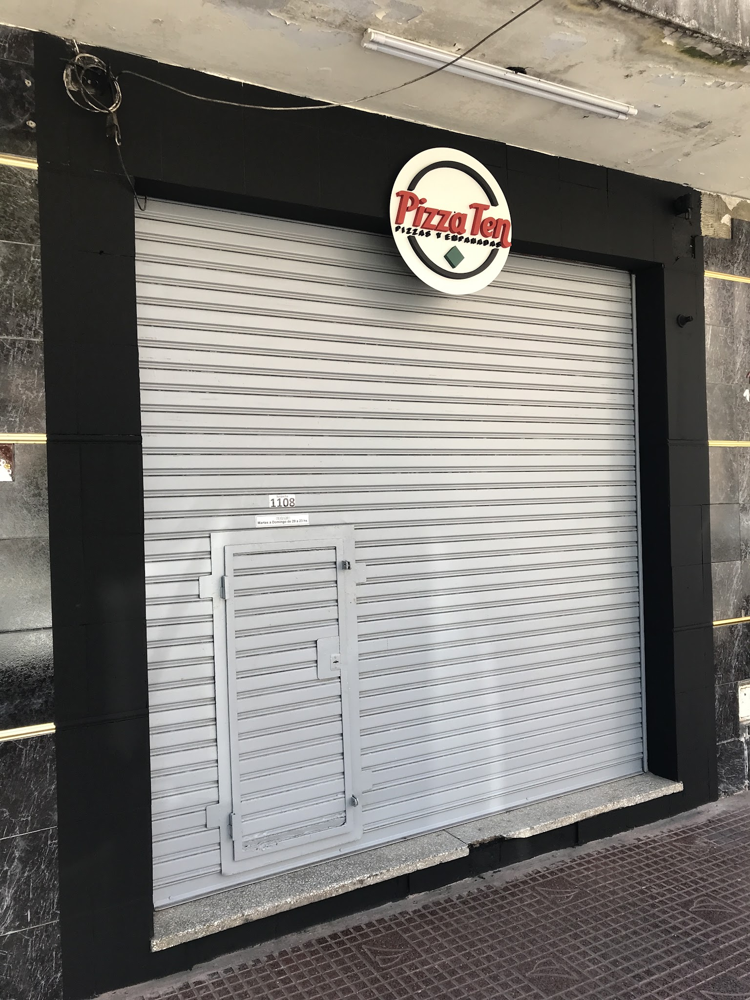
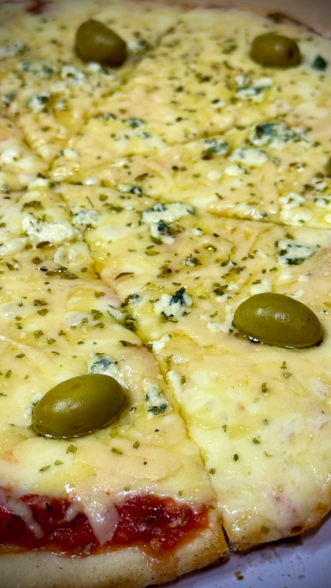
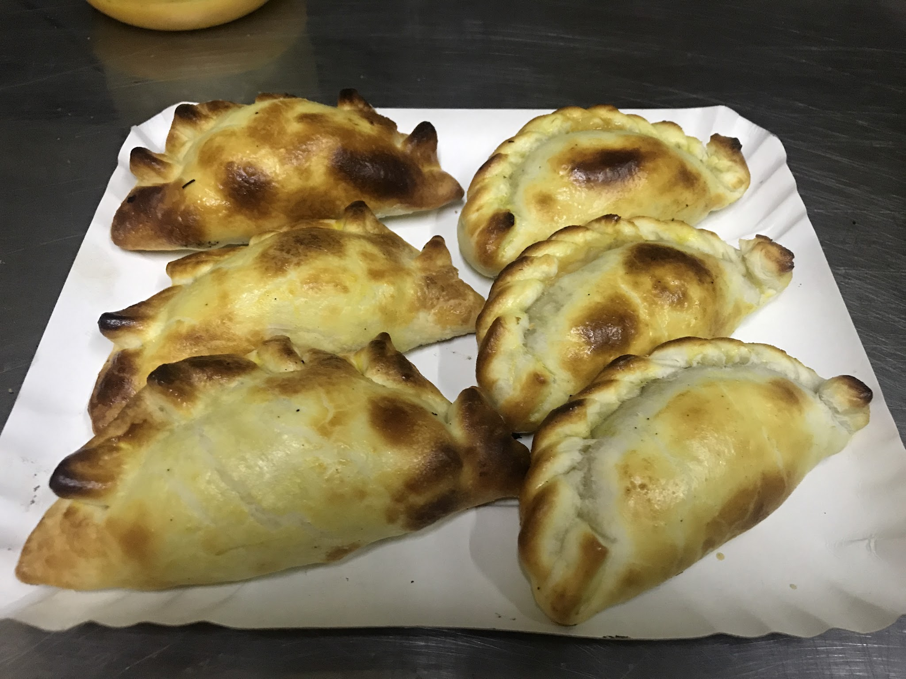
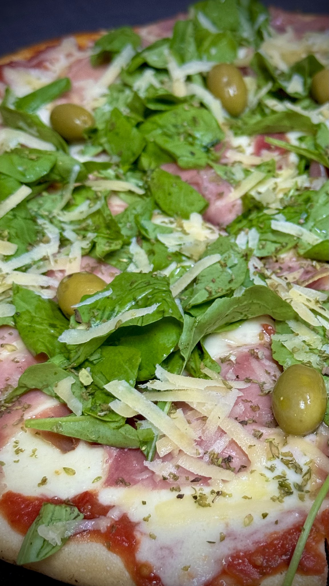
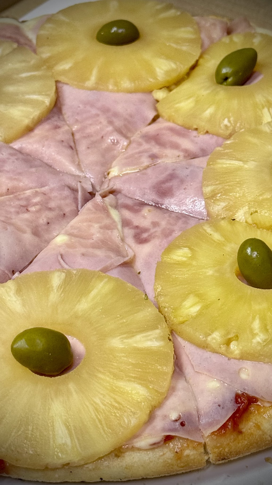
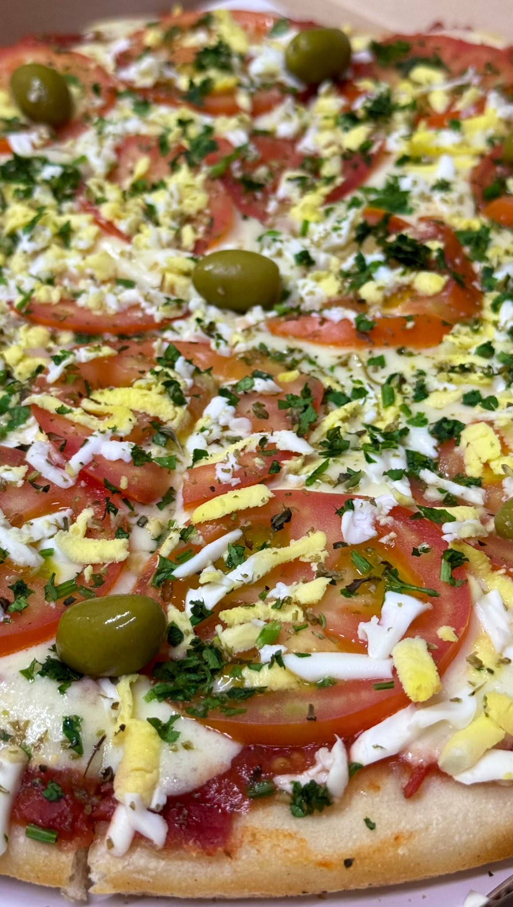

# Pizza Ten

> Extraído el 2026-10-20 19:58 desde [Google Maps](https://www.google.com/maps/place/Pizza+Ten/data=!4m7!3m6!1s0x95bca56a1b93afcd:0x3421ce1911fee756!8m2!3d-34.4515081!4d-58.5717899!16s%2Fg%2F1tdskzkx!19sChIJza-TG2qlvJURVuf-ERnOITQ)

> ⚠️ La galería solo tiene 10 elementos: puede ser el diseño reducido de Google. Repite con `--sin-ficha --sin-resenas` (se acumula).

> ⚠️ La ficha salió recortada (vista limitada de Google): faltan galería de la ficha, horas punta, precio o atributos. Repite solo la ficha con `--sin-resenas --sin-galeria` (~1 min).

> ⚠️ Se han sacado 5 de 156 reseñas: Google sirvió la vista limitada (sin sesión a veces solo enseña 5). Repite con `--sin-ficha --sin-galeria` (~2 min) o inicia sesión una vez con `--login`.

| | |
|---|---|
| **Categoría** | Pizzería |
| **Dirección** | Suipacha 1108, B1646BLX San Fernando, Provincia de Buenos Aires |
| **Teléfono** | 011 6623-7552 |
| **Web** | http://instagram.com/pizzaten_sanfer |
| **Coordenadas** | -34.4515081, -58.5717899 |
| **Plus code** | GCXH+97 San Fernando, Provincia de Buenos Aires |
| **Propietario verificado** | Pizza Ten (propietario) |

## Valoración

**4,4 ★** · 156 reseñas en Google

| Estrellas | Reseñas | % |
|---|--:|---|
| 5 ★ | 103 | █████████████ 66 % |
| 4 ★ | 29 | ████ 19 % |
| 3 ★ | 17 | ██ 11 % |
| 2 ★ | 2 |  1 % |
| 1 ★ | 5 | █ 3 % |

## Horarios

| Día | Horario |
|---|---|
| Lunes | Cerrado |
| Martes | 7:30–10:30 p. m. |
| Miércoles | 7:30–10:30 p. m. |
| Jueves | 7:30–10:30 p. m. |
| Viernes | 7:30–10:30 p. m. |
| Sábado | 7:30–10:30 p. m. |
| Domingo | 7:30–10:30 p. m. |

## Servicios y características

- **Accesibilidad:** ~~Estacionamiento accesible para personas en silla de ruedas~~, ~~Sanitarios accesibles para personas en silla de ruedas~~

## Reseñas extraídas

- **5** reseñas de 156 (google-reviews-scraper-pro)
- Media de las extraídas: **4,0 ★**
- Con respuesta del propietario: 0 (0 %)
- Con fotos: 1 reseñas · 1 fotos descargadas en `fotos_reseñas/`
- Las fechas son aproximadas: Google solo da "hace X meses/años".
- Por año: 2026: 1 · 2025: 1 · 2019: 1 · 2017: 2

### Últimas reseñas

> **★★★★★** · Tatiana · 2026-04-23  
> Primera vez que pedimos, somos de Tigre, a unas cuadras del acceso. Y la verdad nos encantó, súper rica, nos pedimos la pizza napolitana con jamón. Llego súper rápido, en 15 min de no creer un viernes a la noche! Un 10 todo… muy rica pizza, fresca. Excelente servicio. Los felicito, volveremos a comprar!

> **★★★★★** · Sabrina · 2025-10-20  
> Buena relación preció calidad la muzza no es grasosa la aceitunas no son duras el tamaño es estadar y el tiempo de espera es mínimo. Atienden de martes a domingo y hasta las 22:30 podes hacer tu pedido.🍕

> **★☆☆☆☆** · Romina Andrea Maldonado · 2019-10-22  
> Horribles! Después de un tiempo compramos hoy, espantosas! Parecen prepizzas viejas, encima viviendo a 15 cuadras de distancia del lugar llegaron congeladas! Les daría 0 estrella pero no está la opción. Como se nota que no les importa el trabajo, encima que abren solo 2 hrs y media venden esto?? Les importa muu poco perder clientes. NUNCA MÁS

> **★★★★☆** · Luciano Manfredi · 2017-10-22  
> Si vivís en San Fernando no podes dejar de probar estás riquísimas pizza (la especialidad) entre otras comidas que ofrecen. La atención excelente y los precios son económicos, tiene envío a domicilio. Recomendado lugar.

> **★★★★★** · Juan Villanueva · 2017-10-22  
> Muy ricas tanto las pizzas como las empanadas. Tienen variedad y buen precio. Excelente atención y puntualidad en la entrega. Muy recomendable. Juan y Bárbara.

## Galería

**10 fotos y 0 vídeos** (de los vídeos se guarda la portada) en `fotos/`

Por categoría (una foto puede estar en varias):
- Todas: 10

     

## Archivos

- `ficha.json` — ficha completa (gosom)
- `reseñas.json` / `reseñas.csv` — reseñas (el CSV abre directamente en Excel)
- `fotos.json` + `fotos/` — galería en alta resolución
- `fotos_reseñas/` — fotos subidas en las reseñas
- `_raw/` — salidas originales de cada herramienta y sus logs
